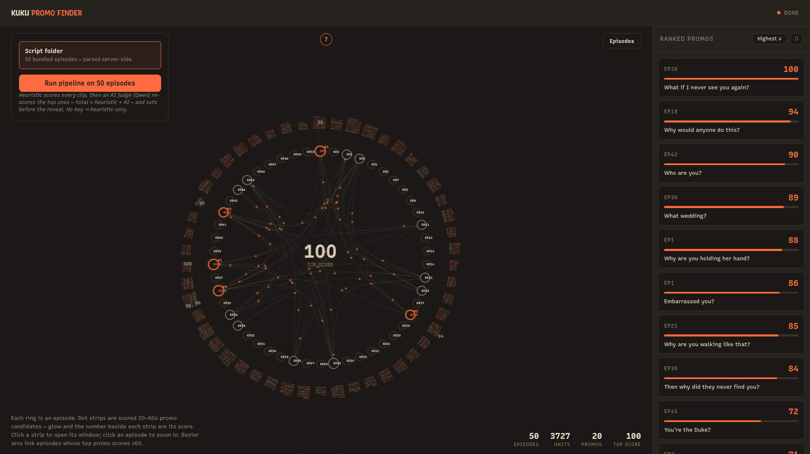
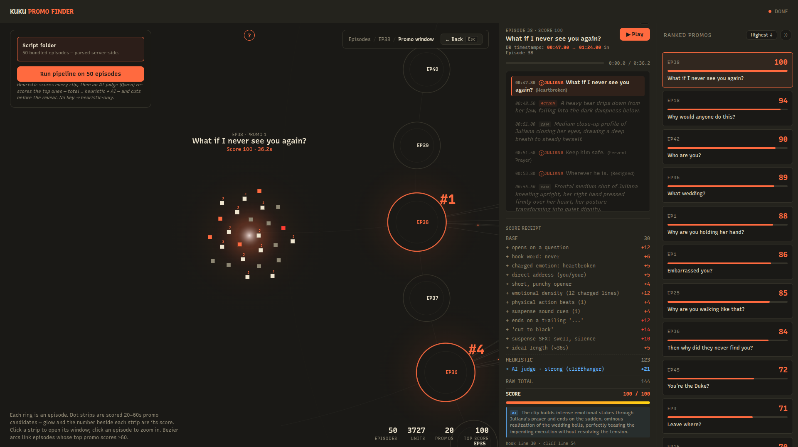

# Kuku Promo Finder

Finds the best **promo clips** inside a 50-episode microdrama screenplay, scores
them, and surfaces the strongest ones to a human editor — so nobody has to watch
all 50 episodes to decide what to cut.

**Live app:** https://frontend-orpin-alpha-31.vercel.app
**API:** https://backend-puce-gamma-97.vercel.app

---

## What it does

- Parses all 50 episode scripts (camera / action / dialogue / sound-fx lines with
  timestamps).
- **Tier 1 — heuristic scorer:** scores every 15–60s candidate window on hook
  strength, cliffhanger pull, emotional density, two-hander conflict, action beats,
  suspense cues, and ideal length. Every point is shown as a transparent receipt.
- **Tier 2 — AI judge (optional):** an LLM (Qwen via Groq, or Anthropic) re-scores
  the top clips and flags any that would spoil a twist. `total = heuristic + AI`.
- **Tier 3 — finalize:** cuts clips *before* the reveal (suspense preservation),
  enforces cross-episode diversity, and normalizes every score to **0–100**.
- Hands the editor each top clip with its **episode number, original database
  timestamps, and full clip script** — ready to cut.

---

## How to use it — step by step

### Step 1 · Open the live app and click **Run pipeline on 50 episodes**

A few seconds later the radial map fills in. Every one of the 50 episodes becomes
a numbered ring (EP01–EP50) around the edge; the dots inside are scored 20–60s
candidate windows. The **top-5 episodes by total score** are ringed in orange
and numbered **#1–#5**, and the big **100 TOP SCORE** in the middle is EP38's
winning clip — *"What if I never see you again?"*

The right rail (**RANKED PROMOS**) lists every clip in score order, so you can
jump straight to any of them.



**What the HUD at the bottom-right is telling you:**

| 50 | 3 727 | 20 | 100 |
|---|---|---|---|
| episodes parsed | script units | promos ranked | top score (EP38) |

### Step 2 · Click a top-5 episode (or any ranked promo) to zoom in

The map focuses on that episode, surrounding episodes slide into a vertical
column, and the detail panel opens on the right. You can see the clip's
**DB timestamps**, the dialogue of the clip **line by line in sync**, and the
full **score receipt** underneath — every point the heuristic scorer awarded,
then the AI judge's signed re-score, then the honest total.



**Reading the receipt (EP38, the #1 clip):**

| | |
|---|---|
| **Hook** | opens on a question `+12`, hook word `+6`, charged emotion `heartbroken` `+5`, direct address `you/your` `+5`, short punchy opener `+4` |
| **Window** | emotional density (12 charged lines) `+12`, physical action beats `+4`, suspense sound cues `+4` |
| **Cliff** | ends on trailing `…` `+12`, `cut to black` `+14`, suspense SFX `swell, silence` `+10` |
| **Duration** | ideal length (~36s) `+5` |
| **HEURISTIC** | **123** |
| **+ AI judge** · strong / cliffhanger | **+21** |
| **RAW TOTAL** | **144** |
| **SCORE (normalized)** | **100 / 100** |

The AI's one-line reason sits below the receipt (*"Builds intense emotional
stakes through Juliana's prayer and ends on the sudden, ominous realization of
the wedding bells, perfectly teasing the impending execution without resolving
the tension."*) — and because the model marked `withholds_reveal: true`, Tier 3
leaves the window as-is. When it marks `withholds_reveal: false`, Tier 3
automatically **trims the window to end before the reveal line** so the clip
keeps its pull.

### Step 3 · Press ▶ Play and watch the clip scroll

The dialogue panel scrolls through the clip's lines in real time, each line
highlighted at its original DB timestamp. This is the editor's confidence check
before they trim — "does it read as a promo?"

### Step 4 · Take the trim timestamps straight to the DB

The top of the detail panel shows the two numbers the editor needs:

```
DB timestamps:  00:47.80  →  01:24.00   in Episode 38
```

That's the full raw output. For a batch workflow, the pipeline also emits
[`deliverables/kuku-promo-finder-top15-clips.txt`](deliverables/kuku-promo-finder-top15-clips.txt)
— a plain text file (same shape as the input scripts) with every top clip's
rank, episode, score, trim window, hook, cliffhanger, AI reason, and full clip
script with original per-line timestamps. One copy-paste and cut.

---

## Run locally

**Backend (script pipeline + optional AI):**
```bash
cd backend
python3 -m venv .venv && source .venv/bin/activate
pip install -r requirements.txt
# optional AI judge — copy the template and add your key:
cp .env.example .env    # then set QWEN_API_KEY (Groq) or ANTHROPIC_API_KEY
python3 dev_server.py 8787
```

**Frontend:**
```bash
cd frontend
npm install
npm run dev        # http://localhost:5173
```
The frontend auto-targets `http://localhost:8787` when run on localhost, and the
deployed backend otherwise — no config edit needed.

## Deployment

Both apps deploy to **Vercel** (serverless — no Docker/containers).

```bash
cd backend  && vercel deploy --prod
cd frontend && vercel deploy --prod
```

### Environment variables

| Where | Variable | Needed? |
|-------|----------|---------|
| **Frontend** (Vercel) | — | **None.** The backend URL is baked into `src/config.js`. |
| **Backend** (Vercel) | `QWEN_API_KEY`, `QWEN_BASE_URL`, `QWEN_MODEL` | **Optional.** Only to enable the AI judge on the deployed site. Left unset, the site runs the heuristic scorer only (fast, no timeout). |

> The AI judge is recommended **locally**, not on Vercel: Groq's free-tier rate
> limit can make a call wait longer than Vercel's function timeout. The deployed
> site runs heuristic-only by design; the local backend runs the full AI pipeline.

Secrets live in `backend/.env`, which is gitignored and never deployed — set any
production keys in the Vercel dashboard (Project → Settings → Environment Variables).

## Project layout

```
backend/
  api/            Vercel serverless entrypoints (pipeline.py = script scorer)
  pipeline/       parser · scorer (Tier 1/3) · ai_judge (Tier 2) · cli
  data/episodes/  the 50 episode scripts
  dev_server.py   local server (script pipeline; AI judge reads .env)
frontend/
  src/            React + Vite · Canvas2D radial map · players · receipt
deliverables/     solution PDF + raw .txt output of top clips
docs/screenshots/ README screenshots
plans/            architecture decision records
```
